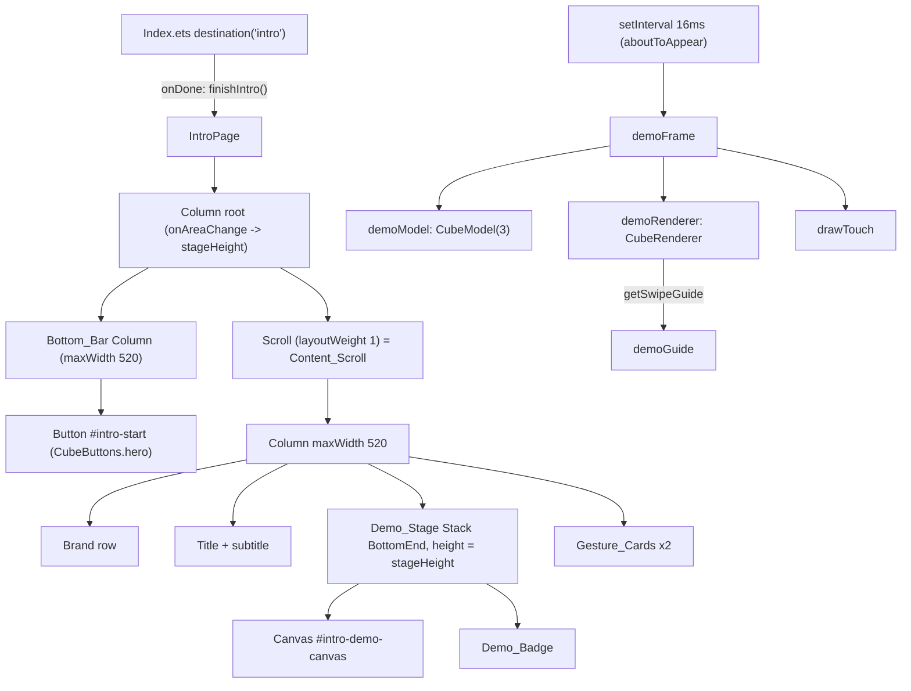

# Design Document

## Overview

This change reworks `entry/src/main/ets/components/IntroPage.ets` only. It touches no other source
file: `CubeRenderer.ets`, `Index.ets`, `CubeTheme.ets`, `CubeStyles.ets` and the string tables stay
as they are.

The two defects have separate fixes:

1. **Slanted demo swipes.** The demo camera moves from the game's three-quarter view
   (`0.62`, `-0.42`) to `DEMO_YAW = 0.22`, `DEMO_PITCH = -0.22`. The demo moves stay the same
   (`y` layer 1 and `x` layer 1, each followed by its inverse). A numerical check against the real
   renderer (see "Camera and move verification") shows that `getSwipeGuide` already returns a path
   that starts on the `+z` Front_Face for every move at this camera. The worst Path_Angle is 3.33°
   for the row swipe and 0.54° for the column swipe, so `CubeRenderer` needs no face preference or
   other change.
2. **Layout.** The root becomes a `Column` that holds a `Scroll` with `layoutWeight(1)` and a fixed
   Bottom_Bar with the Start_Button. The Demo_Badge moves to the stage's bottom-right corner with
   `Stack({ alignContent: Alignment.BottomEnd })`. The stage height comes from the page height and is
   clamped to 220–360vp. The gesture rows become surface-colored cards. Every layout literal is
   replaced with a Theme_Tokens value.

One small behavior fix comes with the adaptive height. The fingertip guide is cached once per cycle,
so a stage resize in the middle of a cycle would leave the fingertip at the old geometry. The design
adds a `demoGuideStale` flag so the guide is recomputed on the next frame after any Canvas resize.
The demo move is not re-applied when this happens (Requirement 2.6, 5.3).

### Out of scope

- The fingertip colors in `drawTouch` (`#FFFFFF`, `#82B5A4`, `#5B8F80`) stay hard-coded hex. They
  are Canvas stroke and fill strings, and `CubeTheme` exposes `Resource` colors that the Canvas 2D
  context cannot consume without new resources or a resolver. The requirements forbid new resources
  (Requirement 6.4), and `CubeRenderer.drawGuide` uses the same hex literals. Requirement 6.3
  governs the ArkUI layout tree, not Canvas painting.
- `CubeRenderer`, the game camera, and the game's guide behavior.
- New strings, icons or color resources.

## Architecture



The demo loop has the same shape as today. Each 2200ms cycle has a press phase (350ms), a travel
phase (1250ms), a release phase (300ms) and a hold. At a cycle boundary the previous move is applied
to `demoModel`, a rest frame is drawn, and the guide is fetched. Every frame then draws the animated
layer and the fingertip with the same eased `progress`.

## Components and Interfaces

### Module constants (IntroPage.ets)

The theme import gains `CubeLayout`:
`import { CubeFont, CubeLayout, CubeRadius, CubeSpace, CubeTheme } from '../pages/CubeTheme';`.

```typescript
// Mostly front-facing: rows read horizontal, columns vertical, and a strip of the
// top face stays visible. The game camera (Index.ets: 0.62 / -0.42) is unchanged.
const DEMO_YAW: number = 0.22;
const DEMO_PITCH: number = -0.22;
const DEMO_CYCLE_MS: number = 2200;
const DEMO_PRESS_MS: number = 350;
const DEMO_TRAVEL_MS: number = 1250;
const DEMO_RELEASE_MS: number = 300;
const DEMO_STAGE_MIN: number = 220;
const DEMO_STAGE_MAX: number = 360;
const DEMO_STAGE_DEFAULT: number = 300;
const DEMO_STAGE_RATIO: number = 0.4;
const CONTENT_MAX_WIDTH: number = 520;

/** Demo_Stage height (vp) for the measured Intro_Page height; 300 until measured. */
export function demoStageHeight(pageHeight: number): number {
  if (!Number.isFinite(pageHeight) || pageHeight <= 0) { return DEMO_STAGE_DEFAULT; }
  return Math.max(DEMO_STAGE_MIN, Math.min(DEMO_STAGE_MAX, Math.round(pageHeight * DEMO_STAGE_RATIO)));
}
```

`demoStageHeight` is a top-level pure function so the node test can extract it from the source and
evaluate it, the same way `cube-game.test.mjs` extracts `Index.ets` members. With ratio 0.4, a page
height of 600vp gives 240, 720vp gives 288, 800vp gives 320, and 900vp or more gives 360. Pages
shorter than 550vp use the 220 floor and scroll.

`CONTENT_MAX_WIDTH` replaces the `520` literal that both the scroll content and the Bottom_Bar use
(Requirement 3.7). `CubeLayout.contentMaxWidth` is 600, which does not match the existing 520, so the
design keeps 520 as a named constant instead of changing the width.

### IntroPage state

| Field | Kind | Change |
|---|---|---|
| `onDone` | callback | unchanged |
| `stageHeight` | `@State number = DEMO_STAGE_DEFAULT` | new; set from the root `onAreaChange` |
| `demoModel`, `demoRenderer`, `demoContext` | private | unchanged |
| `demoReady`, `demoWidth`, `demoHeight` | private | unchanged |
| `demoStarted`, `demoCycle`, `demoGuide`, `demoTimer` | private | unchanged |
| `demoGuideStale` | `private boolean = true` | new; set by Canvas `onAreaChange` |
| `demoBase` | `CubeMove[]` | unchanged: `[new CubeMove('y', 1, 1), new CubeMove('x', 1, 1)]` |

`aboutToAppear` and `aboutToDisappear` are unchanged: the timer starts with `setInterval` and is
cleared with `clearInterval` (Requirement 7.3).

### demoFrame

```typescript
private demoFrame(): void {
  if (!this.demoReady || this.demoWidth <= 0 || this.demoHeight <= 0) { return; }
  const now = Date.now();
  if (this.demoStarted < 0) { this.demoStarted = now; }
  const elapsed = now - this.demoStarted;
  const cycle = Math.floor(elapsed / DEMO_CYCLE_MS);
  const t = elapsed - cycle * DEMO_CYCLE_MS;
  if (cycle !== this.demoCycle) {
    if (this.demoCycle >= 0) { this.demoModel.applyMove(this.demoMove(this.demoCycle), false); }
    this.demoCycle = cycle;
    this.demoGuideStale = true;
  }
  // A rest frame is required: getSwipeGuide only answers for a stable, current frame.
  if (this.demoGuideStale) {
    this.demoGuideStale = false;
    this.demoRenderer.draw(this.demoContext, this.demoWidth, this.demoHeight,
      this.demoModel, DEMO_YAW, DEMO_PITCH);
    this.demoGuide = this.demoRenderer.getSwipeGuide(this.demoMove(cycle));
  }
  const travel = Math.max(0, Math.min(1, (t - DEMO_PRESS_MS) / DEMO_TRAVEL_MS));
  const progress = travel * travel * (3 - 2 * travel);
  const move = this.demoMove(cycle);
  this.demoRenderer.draw(this.demoContext, this.demoWidth, this.demoHeight,
    this.demoModel, DEMO_YAW, DEMO_PITCH, move, progress);
  this.drawTouch(t, progress);
}
```

- The same `move` and `progress` drive the layer rotation and the fingertip, because `drawTouch`
  interpolates `demoGuide` with `progress` (Requirement 2.6).
- `drawTouch` keeps its `if (guide === null) { return; }` guard. When the guide is null, the layer
  animates with no fingertip (Requirement 2.7).
- The Canvas `onAreaChange` sets `demoWidth`, `demoHeight` and `demoGuideStale = true`. The next
  timer tick redraws at the new size and refetches the guide (Requirement 5.3).

### Layout tree (build)

```typescript
build() {
  Column() {
    Scroll() {
      Column({ space: CubeSpace.m }) {
        // 1. Brand row
        Row({ space: CubeSpace.s }) {
          BrandMark()
          Column({ space: CubeSpace.xxs }) {
            Text($r('app.string.brand_name')).fontSize(CubeFont.label).letterSpacing(1.5)
              .fontWeight(FontWeight.Bold).fontColor(CubeTheme.ink)
            Text($r('app.string.brand_tagline')).fontSize(CubeFont.caption).fontColor(CubeTheme.secondary)
          }.alignItems(HorizontalAlign.Start).layoutWeight(1)
        }.width('100%').constraintSize({ minHeight: CubeLayout.touchTarget })
        // 2. Title + subtitle
        Column({ space: CubeSpace.xs }) {
          Text($r('app.string.intro_title')).fontSize(CubeFont.title).fontWeight(FontWeight.Bold)
            .fontColor(CubeTheme.ink).textAlign(TextAlign.Center)
          Text($r('app.string.intro_subtitle')).fontSize(CubeFont.body).fontColor(CubeTheme.secondary)
            .textAlign(TextAlign.Center)
        }.width('100%')
        // 3. Demo_Stage
        Stack({ alignContent: Alignment.BottomEnd }) {
          Canvas(this.demoContext)
            .id('intro-demo-canvas')
            .width('100%').height('100%')
            .hitTestBehavior(HitTestMode.None)
            .accessibilityLevel('no')
            .onReady(() => { this.demoReady = true; })
            .onDisAppear(() => { this.demoReady = false; })
            .onAreaChange((_old: Area, area: Area) => {
              this.demoWidth = Number(area.width);
              this.demoHeight = Number(area.height);
              this.demoGuideStale = true;
            })
          Text($r('app.string.intro_demo_badge')).fontSize(CubeFont.caption).fontColor(CubeTheme.green)
            .padding({ left: CubeSpace.xs, right: CubeSpace.xs, top: CubeSpace.xxs, bottom: CubeSpace.xxs })
            .margin({ right: CubeSpace.s, bottom: CubeSpace.s })
            .backgroundColor(CubeTheme.overlay).borderRadius(CubeRadius.m)
            .hitTestBehavior(HitTestMode.None)
        }.width('100%').height(this.stageHeight)
          .linearGradient({ angle: 135, colors: [[CubeTheme.stageStart, 0], [CubeTheme.stageEnd, 1]] })
          .borderRadius(CubeRadius.xl).clip(true)
          .accessibilityText($r('app.string.intro_stage_accessibility'))
        // 4. Gesture_Cards
        Column({ space: CubeSpace.s }) {
          this.gestureCard($r('sys.symbol.hand_tap'), $r('app.string.intro_swipe_title'),
            $r('app.string.intro_swipe_desc'))
          this.gestureCard($r('sys.symbol.arrow_counterclockwise'), $r('app.string.intro_orbit_title'),
            $r('app.string.intro_orbit_desc'))
        }.width('100%')
      }.width('100%').constraintSize({ maxWidth: CONTENT_MAX_WIDTH })
        .padding({ left: CubeSpace.l, right: CubeSpace.l, top: CubeSpace.s, bottom: CubeSpace.m })
    }.width('100%').layoutWeight(1).scrollBar(BarState.Off).align(Alignment.Top)
    // 5. Bottom_Bar: outside the Scroll, so it never scrolls away or gets covered.
    Column() {
      Button({ type: ButtonType.Normal }) {
        Row({ space: CubeSpace.xs }) {
          Text($r('app.string.intro_start')).fontSize(CubeFont.headline).fontWeight(FontWeight.Bold)
            .fontColor(CubeTheme.onAccent)
          SymbolGlyph($r('sys.symbol.arrow_right')).fontSize(CubeFont.headline).fontColor([CubeTheme.onAccent])
        }
      }.width('100%').attributeModifier(CubeButtons.hero).id('intro-start')
        .accessibilityText($r('app.string.intro_start'))
        .onClick(() => this.onDone())
    }.width('100%').constraintSize({ maxWidth: CONTENT_MAX_WIDTH })
      .padding({ left: CubeSpace.l, right: CubeSpace.l, top: CubeSpace.s, bottom: CubeSpace.m })
  }.width('100%').height('100%').alignItems(HorizontalAlign.Center)
    .onAreaChange((_old: Area, area: Area) => {
      const next = demoStageHeight(Number(area.height));
      if (next !== this.stageHeight) { this.stageHeight = next; }
    })
}
```

### Gesture_Card builder

`gestureRow` is renamed to `gestureCard`. It uses the existing `Row` with card styling instead of
`CubeCards.surface`, because `CardStyle` is an `AttributeModifier<ColumnAttribute>` and uses
`CubeRadius.xl` with 18vp padding. A card that is a short single row reads better at `CubeRadius.l`
with `CubeSpace.m` padding.

```typescript
@Builder
private gestureCard(icon: Resource, title: ResourceStr, description: ResourceStr) {
  Row({ space: CubeSpace.s }) {
    Stack({ alignContent: Alignment.Center }) {
      SymbolGlyph(icon).fontSize(CubeFont.headline).fontColor([CubeTheme.green])
    }.width(CubeLayout.touchTarget).height(CubeLayout.touchTarget)
      .backgroundColor(CubeTheme.mint).borderRadius(CubeRadius.m)
    Column({ space: CubeSpace.xxs }) {
      Text(title).fontSize(CubeFont.subhead).fontWeight(FontWeight.Medium).fontColor(CubeTheme.ink)
      Text(description).fontSize(CubeFont.caption).fontColor(CubeTheme.secondary)
    }.alignItems(HorizontalAlign.Start).layoutWeight(1)
  }.width('100%').padding(CubeSpace.m).backgroundColor(CubeTheme.surface).borderRadius(CubeRadius.l)
}
```

### Literal-to-token mapping

| Old literal | Where | New value |
|---|---|---|
| `0.62` / `-0.42` | demo camera | `DEMO_YAW = 0.22` / `DEMO_PITCH = -0.22` |
| `Row({ space: 10 })` | brand row | `CubeSpace.s` (12) |
| `Column({ space: 2 })`, `Column({ space: 3 })` | brand text, card text | `CubeSpace.xxs` (4) |
| `.height(44)` | brand row | `constraintSize({ minHeight: CubeLayout.touchTarget })` |
| `.width(44).height(44)` | gesture icon tile | `CubeLayout.touchTarget` (48) |
| `fontSize(20)` | symbol glyphs | `CubeFont.headline` (17) |
| `.lineHeight(17)` | card description | removed (default line height) |
| `height(300)` | stage | `this.stageHeight` (220–360) |
| `borderRadius(28)` | stage | `CubeRadius.xl` (24) |
| badge padding `10` / `4` | badge | `CubeSpace.xs` / `CubeSpace.xxs` |
| badge `margin({ bottom: CubeSpace.s })` | badge | `margin({ right: CubeSpace.s, bottom: CubeSpace.s })` |
| `padding 22 / 12 / 22` | content | `CubeSpace.l` / `CubeSpace.s` / `CubeSpace.m` |
| `maxWidth: 520` | content, bar | `CONTENT_MAX_WIDTH` |

`letterSpacing(1.5)` on the brand name and `linearGradient({ angle: 135 })` stay as literals. They
are type tracking and a gradient angle, not color, font size, spacing, radius or touch-target
values. They match the brand row and stage styling used elsewhere in the app.

### Safe area

The app does not opt into immersive layout. No source file calls `setWindowLayoutFullScreen`,
`expandSafeArea` or `ignoreLayoutSafeArea`. `NavDestination` content is therefore laid out inside
the window's safe area, and the system keeps it clear of the status bar and navigation indicator.
The Bottom_Bar sits at the bottom of the destination's content area, above the indicator, with
`CubeSpace.m` bottom padding as visual breathing room. The Bottom_Bar does not call
`expandSafeArea`. The `NavDestination` already paints `CubeTheme.background` behind the bar, so the
bar needs no background of its own (Requirement 3.2). If the app later goes immersive, the
Bottom_Bar is the one place that would need a bottom avoid-area padding.

## Data Models

The design adds no persistent data. The `CubeSettings.onboarded` flow in `Index.ets` is unchanged.

The demo sequence is defined by `demoMove(index)`:

| Cycle index | Move | Model before the move |
|---|---|---|
| 0 | `y` layer 1, +1 (Row_Swipe) | solved |
| 1 | `y` layer 1, −1 | middle row turned |
| 2 | `x` layer 1, +1 (Column_Swipe) | solved |
| 3 | `x` layer 1, −1 | middle column turned |
| 4… | repeats | solved |

## Camera and move verification

The verification used a scratch script in `%TEMP%`. It loads the real `CubeModel.ts` and
`CubeRenderer.ets` through `stripTypeScriptTypes`, the same way `tests/cube-renderer.test.mjs`
does, and plays each move and its inverse on a real `CubeModel(3)`. For each move it measures the
`getSwipeGuide` segment angle and checks that the start point's `boxHit` normal is `+z`. Stage sizes
were 276×220, 316×220, 316×280, 316×360, 360×300, 476×220 and 476×360, re-checked at 240×220,
280×220, 480×220 and 480×360 after the content padding moved from 22 to `CubeSpace.l` (20). Widths
run from a narrow phone minus padding (320 − 2 × 20 = 280) up to the 520 maximum minus padding
(480); heights cover the clamp range. The worst angles below did not change.

### Why the Front_Face wins without a renderer change

`getSwipeGuide` only scores stickers of the turning layer. It skips any sticker whose
`swipeTangent` has zero length:

- For a `y` move, the tangent is `(normal.z, 0, -normal.x)`. It is zero on the top and bottom faces,
  so only the front face and the right side face (visible when yaw > 0) are candidates. At yaw 0.22
  the right face is foreshortened to about `sin(0.22) ≈ 0.22` of its width. That face's sticker
  `area`, clearance and `travel` (capped by `guideEndpointFits` staying on one face) all lose to the
  front sticker in `quality = travel + sqrt(area) + 2 * clearance`.
- For an `x` move, the tangent is `(0, -normal.z, normal.y)`. It is zero on the left and right
  faces, so only the front face and the top strip are candidates. At pitch −0.22 the top strip is
  foreshortened the same way and loses on the same terms.

Results (worst angle over all sizes, move and inverse; every guide non-null and on `+z`):

| Camera | x0 | **x1** | x2 | y0 | **y1** | y2 |
|---|---|---|---|---|---|---|
| yaw 0.22, pitch −0.22 (chosen) | 2.14° | **0.54°** | 1.16° | 4.89° | **3.33°** | 1.68° |
| yaw 0.35, pitch −0.35 (range corner) | 3.81° | 1.39° | 1.29° | 10.72° | 8.50° | 6.03° |
| yaw 0.15, pitch −0.15 (range corner) | 1.36° | 0.25° | 0.91° | 2.64° | 1.54° | 0.40° |

The chosen camera leaves at least 4.6° of margin for both demo moves. Row-swipe slant grows with
`|yaw| · |pitch|`, so the far corner of the allowed range would exceed 8° for rows. The design
picks the middle of the range instead. The middle layers keep the fingertip near the stage center,
where perspective adds the least slant.

## Error Handling

| Condition | Behavior |
|---|---|
| Canvas not ready, or width/height ≤ 0 | `demoFrame` returns early; nothing is drawn (unchanged). |
| `getSwipeGuide` returns null (tiny stage, stale frame) | `demoGuide = null`; the layer still animates and `drawTouch` returns early (Requirement 2.7). |
| Stage resized during a cycle | Canvas `onAreaChange` sets `demoGuideStale`; the next frame redraws the rest frame at the new size and refetches the guide without re-applying a move. |
| Page height not yet measured, `NaN` or ≤ 0 | `demoStageHeight` returns 300. |
| Page shorter than the content | Content_Scroll scrolls; the Bottom_Bar stays fixed. |
| Page disappears | `aboutToDisappear` clears the timer; Canvas `onDisAppear` clears `demoReady`. |

## Correctness Properties

*A property is a characteristic or behavior that should hold true across all valid executions of a
system-essentially, a formal statement about what the system should do. Properties serve as the
bridge between human-readable specifications and machine-verifiable correctness guarantees.*

After reflection, criteria 2.2, 2.3 and 2.4 share one generator (stage size × demo sequence
position) and one guide, so the first property below combines them. The second covers the
"returns to solved" part of criterion 2.5, and the third covers criterion 5.2. The remaining
criteria are single-example source checks listed under Testing Strategy.

### Property 1: Demo guides are front-face and axis-aligned

*For any* Demo_Stage size with width in [280, 480] and height in [220, 360], and *for any* cycle
index `i` in the Demo_Sequence, the following holds after the moves `demoMove(0..i-1)` are applied
to a fresh `CubeModel(3)` and a rest frame is drawn at `DEMO_YAW` / `DEMO_PITCH`.
`getSwipeGuide(demoMove(i))` is non-null. Its start point hits a sticker whose normal is `+z` and
whose layer coordinate on `demoMove(i).axis` equals `demoMove(i).layer`. Its Path_Angle is at most
8° from screen horizontal when the axis is `y`, and at most 8° from screen vertical when the axis is
`x`.

**Validates: Requirements 2.2, 2.3, 2.4, 1.1, 1.2**

### Property 2: Demo_Sequence pairs return the model to solved

*For any* pair count `n ≥ 1`, applying `demoMove(0)` through `demoMove(2n − 1)` to a solved
`CubeModel(3)` leaves the model solved. The sequence over one period contains at least one `y`-axis
move and at least one `x`-axis move.

**Validates: Requirements 2.5**

### Property 3: Stage height is clamped and monotone

*For any* number `h`, including negative values, zero, `NaN` and ±Infinity, `demoStageHeight(h)` is
an integer in [220, 360]. *For any* two finite positive heights `a ≤ b`, `demoStageHeight(a) ≤
demoStageHeight(b)`.

**Validates: Requirements 5.1, 5.2**

## Testing Strategy

The repository has no package manager and no property-testing library. Tests are dependency-free
`node:test` files run with `node --unhandled-rejections=strict --test tests/*.test.mjs`. Property
tests therefore use a small seeded PRNG (for example mulberry32) inside a loop of at least 100
iterations. On failure they print the seed and the generated input. Each property test is tagged
with a comment in the form `// Feature: intro-gesture-polish, Property N: <title>`.

### New file: `tests/intro-demo.test.mjs`

Setup mirrors `tests/cube-renderer.test.mjs`. It strips types from `CubeModel.ts` and
`CubeRenderer.ets` into a `mkdtemp` directory, imports them, and removes the directory in `after`.
It reads `IntroPage.ets` as text and extracts:

- `DEMO_YAW` and `DEMO_PITCH` with `/const DEMO_YAW: number = (-?[\d.]+);/`;
- `demoBase` moves with `/new CubeMove\('([xyz])', (\d+), (-?1)\)/g` inside the `demoBase`
  initializer;
- the `demoStageHeight` function and the `DEMO_STAGE_*` constants. These are evaluated with
  `stripTypeScriptTypes` and `vm`, after removing the `export` keyword.

A JS `demoMove(index)` is rebuilt from the extracted base list with the same formula as
IntroPage. The test also asserts that this formula appears verbatim in the source, so the mirror
cannot drift.

Property tests:

1. **Property 1.** 100+ iterations over random `(w, h)`, all four sequence positions per size. The
   test reads the start-point hit through the renderer's `boxHit`. TypeScript `private` is erased, as
   `cube-renderer.test.mjs` already relies on.
2. **Property 2.** 100 random `n` in [1, 40].
3. **Property 3.** 200 random values from a mix of uniform [−1000, 3000], integers, and the fixed
   specials `NaN`, `±Infinity`, `0` and `-0`, plus sorted pairs for monotonicity.

Example and source-shape checks, in the same regex style as `cube-ui.test.mjs`:

- `DEMO_YAW` absolute value in [0.15, 0.35] and `DEMO_PITCH` in [−0.35, −0.15] (1.1, 1.2);
  both draw calls in `demoFrame` pass `DEMO_YAW, DEMO_PITCH` (1.3); `Index.ets` still sets
  `private yaw: number = 0.62;` and `private pitch: number = -0.42;` (1.4).
- `demoFrame` calls `getSwipeGuide(this.demoMove(cycle))` after a rest `draw`, and uses one
  `move`/`progress` pair for `draw` and `drawTouch` (2.1, 2.6); `drawTouch` keeps
  `if (guide === null) { return; }` (2.7).
- `build` order: `Scroll()` precedes the Bottom_Bar; the `Scroll` chain contains `.layoutWeight(1)`;
  the `intro-start` button appears after the Scroll block closes; the Bottom_Bar uses
  `constraintSize({ maxWidth: CONTENT_MAX_WIDTH })` and `CONTENT_MAX_WIDTH` is 520 (3.1, 3.4, 3.7).
- The button keeps `.attributeModifier(CubeButtons.hero).id('intro-start')`,
  `.accessibilityText($r('app.string.intro_start'))`, `sys.symbol.arrow_right` and
  `.onClick(() => this.onDone())` (3.5, 3.6, 6.6).
- `Stack({ alignContent: Alignment.BottomEnd })`, badge `.margin({ right: CubeSpace.s, bottom:
  CubeSpace.s })`, `CubeTheme.overlay` and `HitTestMode.None` (4.1–4.3).
- Root `onAreaChange` calls `demoStageHeight(`; the stage uses `.height(this.stageHeight)`; Canvas
  `onAreaChange` sets `this.demoGuideStale = true`; gradient, `.clip(true)` and the stage
  accessibility text remain (5.1, 5.3, 5.4).
- Marker order in `build`: `brand_name` < `intro_title` < `intro-demo-canvas` < `intro_swipe_title`
  < `intro-start` (6.1). `gestureCard` has `.backgroundColor(CubeTheme.surface)`, `.borderRadius(
  CubeRadius.` and `.padding(CubeSpace.` (6.2).
- In `build` and `gestureCard`: no numeric literal inside `fontSize(`, `padding(`, `margin(`,
  `space:`, `borderRadius(`, `width(` or `height(`, and no `#` hex color (6.3); every `fontSize(`
  argument is `CubeFont.*` (6.5).
- The set of `$r('app.string.…')` keys equals the pre-change set: `brand_name`, `brand_tagline`,
  `intro_title`, `intro_subtitle`, `intro_demo_badge`, `intro_stage_accessibility`,
  `intro_swipe_title`, `intro_swipe_desc`, `intro_orbit_title`, `intro_orbit_desc` and
  `intro_start` (6.4).
- `new CubeModel(3)` and `new CubeRenderer()` fields; no `AppStorage`, `CubeStore` or
  `PersistentStorage` (7.1, 7.2); `setInterval` in `aboutToAppear` and `clearInterval` in
  `aboutToDisappear` (7.3); Canvas id, `HitTestMode.None` and `accessibilityLevel('no')` (7.4).

### Existing Test_Suite impact (Requirement 7.5, 7.6)

No existing assertion conflicts with the restructure, so no existing test file needs editing:

- `tests/cube-ui.test.mjs` refers to the intro only through `Index.ets`: the
  `IntroPage({ onDone: () => this.finishIntro() })` destination, plus `loadData`, `finishIntro`,
  `onBackPress` and `saveSettings`. None of those change. Its `components` list does not include
  `IntroPage`, so the "not the game model" check does not apply to it.
- `tests/cube-game.test.mjs` exercises `finishIntro` routing and persistence on extracted
  `Index.ets` members only. No change.
- `tests/cube-localization.test.mjs` scans `IntroPage.ets` for hard-coded CJK, literal
  `Text('…')`/`Button('…')` labels, and string keys missing in any locale. The design uses only
  existing keys and no literals, so it still passes.
- `tests/cube-store.test.mjs` covers `onboarded` persistence. No change.
- `scripts/smoke.mjs` finds the start button by its `intro_start` text with `button()` and
  `usable()`, which require the node to be visible within the viewport, then taps it. The fixed
  Bottom_Bar keeps the button on screen at launch on every screen height, so smoke detection is more
  reliable. No change.

### Device check (manual, not automated)

After `.\scripts\build.ps1` and install, use the AGENTS.md hdc flow with
`uitest dumpLayout` and a screenshot. Check that `intro-start` bounds sit above the navigation
indicator, that the badge is in the stage's bottom-right corner, and that the row and column swipe
fingertips look horizontal and vertical.
